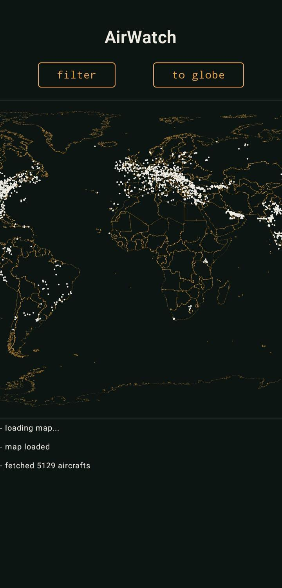
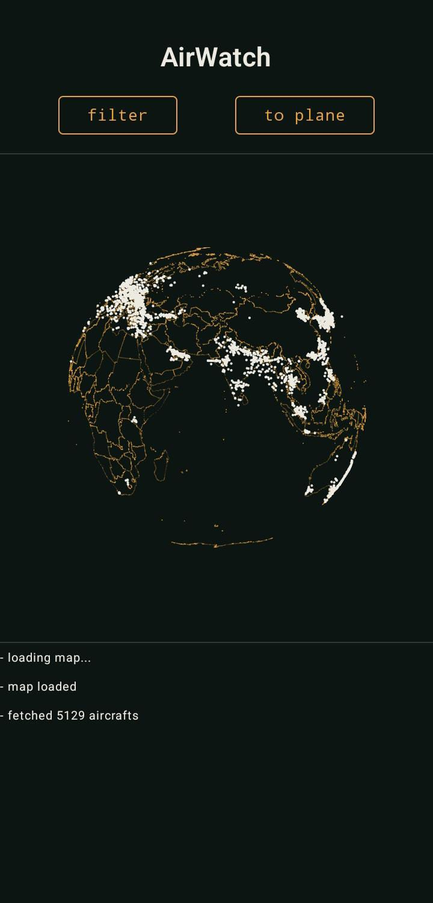

# AirWatch

A live aircraft tracker built with **Kotlin Multiplatform** and **Compose Multiplatform**. AirWatch pulls real-time flight data from the [OpenSky Network](https://opensky-network.org/) and draws it on a custom-rendered world map, switchable between a flat map and a 3D globe. The UI is shared between Android and iOS.

<p align="center">
  
  &nbsp;&nbsp;
  
</p>

## Features

- **Live tracking.** Aircraft positions refresh automatically from OpenSky's `/states/all` endpoint.
- **Two map views.** Toggle between an equirectangular flat map and an orthographic globe.
- **Pan and zoom.** Pinch, drag and zoom on both views. The flat map clamps panning to the map bounds.
- **Aircraft details.** Tap a plane to open a card with ICAO24, position, origin country, barometric and geometric altitude, velocity, track and vertical rate.
- **Filtering.** Narrow the map by any combination of:
    - ICAO24 address
    - Origin country
    - Area (bounding box by coordinates)
    - Altitude range
    - Velocity range
    - Direction (true track)
- **Radar-style UI.** A dark amber-and-teal theme with an in-app log console.

## How it works

**Rendering.** There are no map tiles or third-party map SDKs. Country borders ship as bundled JSON (`WorldMapLowRes.json`, `WorldMapMedRes.json`) and are loaded into a **quadtree** of `Chunk`s. On each frame the tree is traversed with a level-of-detail threshold: chunks that are off-screen are skipped, and chunks that are small on screen are drawn at coarse detail. The threshold relaxes while a gesture is active to keep panning smooth.

**Projections.** A `Projection` interface keeps the map logic independent of the view. `EquirectangularProjection` handles the flat map. `OrthographicProjection` handles the globe, rotating points around the camera and culling anything on the far side of the sphere.

**Rate-limit-aware polling.** `FlightTracker` reads OpenSky's `X-Rate-Limit-Remaining` header and spreads the remaining credits evenly until midnight UTC. If it receives a `429`, it waits for the `Retry-After` interval. Authentication uses the OAuth2 client-credentials flow, and the token is cached until shortly before it expires.

## Project structure

```
AirWatch/
├── androidApp/   # Android entry point
├── iosApp/       # Xcode project (SwiftUI host)
└── shared/       # Kotlin Multiplatform module (all app logic and UI)
    └── src/commonMain/kotlin/org/airwatch/project/
        ├── Aircraft/            # Data model, view model, OpenSky JSON mapping
        ├── APICommunication/    # Ktor client, OpenSky auth, polling flow
        ├── Filter/              # Filter state, logic and sidebar UI
        ├── WorldMap/            # Quadtree, projections, canvas, detail card
        ├── screens/             # Main screen
        └── UIComponents/        # Theme and shared composables
```

## Tech stack

| Area | Library |
| --- | --- |
| Language | Kotlin 2.4.0 |
| UI | Compose Multiplatform 1.11.1, Material 3 |
| Networking | Ktor 3.5.1 (OkHttp on Android, Darwin on iOS) |
| Serialization | kotlinx.serialization |
| Time | kotlinx-datetime |
| Build | Gradle with version catalog, AGP 9.2.1 |

**Targets:** Android (minSdk 24, compileSdk 36), iOS (`iosArm64`, `iosSimulatorArm64`).

## Getting started

### 1. Get OpenSky API credentials

Create an API client in your [OpenSky account](https://opensky-network.org/) to get a client ID and secret.

### 2. Add them to `local.properties`

In the project root, create or edit `local.properties`. This file is git-ignored, so your secrets stay out of version control:

```properties
OPENSKY_CLIENT_ID=your-client-id
OPENSKY_CLIENT_SECRET=your-client-secret
```

The Gradle build injects these into a generated `BuildConfig` at compile time.

### 3. Run

**Android**

```bash
./gradlew :androidApp:installDebug
```

Or open the project in Android Studio and run the `androidApp` configuration.

**iOS** (requires macOS and Xcode)

Open `iosApp/iosApp.xcodeproj` in Xcode and run on a simulator or device. Xcode builds the `Shared` framework from the `shared` module.

## Notes

- OpenSky applies daily credit limits per account. AirWatch adapts its polling to stay inside them, so update frequency varies with your remaining credits.
- Without valid credentials, the app starts but no aircraft will load.

## Known Limitations

**Frame rate while panning and zooming.** Because the map is drawn by hand on a Compose `Canvas` rather than with a tile-based map SDK, frame rate can drop during panning and zooming, especially on lower-end devices or when zoomed in on dense regions. Every frame, the app re-traverses the map quadtree, reprojects the visible border points and redraws every aircraft. To keep gestures responsive, the level-of-detail threshold is relaxed while a finger is down, so borders look coarser during a gesture and sharpen once it ends. The globe view does more per-point math than the flat map, so it may feel heavier. Performance has not been formally benchmarked, and results will vary by device.

## Acknowledgements

- Flight data from the [OpenSky Network](https://opensky-network.org/).
